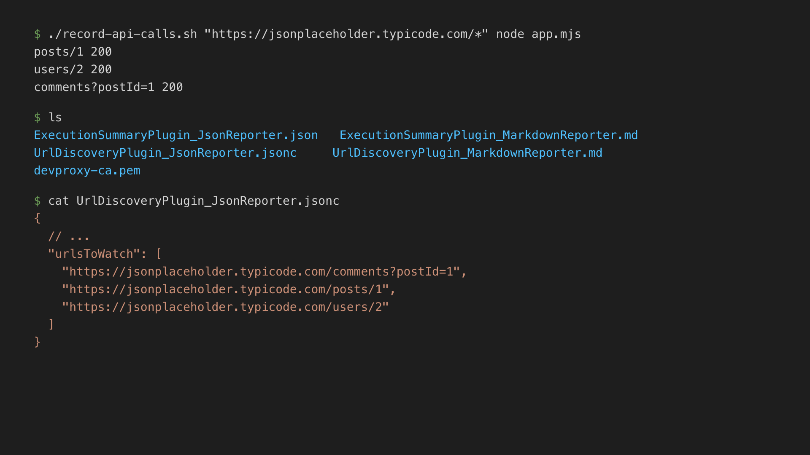

# Record your app's API calls in CI

## Summary

This sample contains a preset to record which APIs your app calls, for example in a CI pipeline.

You want a list of the APIs that your app calls, but the default Dev Proxy config simulates random errors, and `devproxy config new` gives you an empty config. Picking the right plugins and reporters yourself takes time, and different people end up with different setups.

Using this preset, you start Dev Proxy in the background, start and stop recording through the Dev Proxy API around your app, and get a list of the URLs your app called and a summary of the requests. Dev Proxy doesn't change the requests or responses, and doesn't register itself as the system proxy.



## Compatibility


## Contributors

- [Waldek Mastykarz](https://github.com/waldekmastykarz)

## Version history

Version|Date|Comments
-------|----|--------
1.0|November 5, 2026|Initial release

## Minimal path to awesome

- Get the sample:
  - Download just this sample:

      ```bash
      npx gitload-cli https://github.com/pnp/proxy-samples/tree/main/samples/api-inventory
      ```

    or

  - [Download as a .ZIP file](https://pnp.github.io/download-partial/?url=https://github.com/pnp/proxy-samples/tree/main/samples/api-inventory) and unzip it, or
  - Clone this repository

  Alternatively, download the preset with Dev Proxy:

  ```bash
  devproxy config get api-inventory
  ```

  Dev Proxy saves the preset in `~dataFolder/configs/api-inventory`. Run `devproxy config get api-inventory --output json` to get the full path.
- Run your app through Dev Proxy with the `record-api-calls.sh` script. Pass the URLs that you want to record and the command that starts your app. Run the script from the folder where you want to save the reports:

    ```bash
    ./record-api-calls.sh "https://api.contoso.com/*" npm start
    ```

- After your app exits, review the reports in the current folder.

The script requires `devproxy`, `curl`, and `jq`. The command that starts your app must exit on its own, for example, a test run or a script that calls the APIs and stops. If you downloaded the preset with `devproxy config get`, run the script with `bash`, for example, `bash "<path>/record-api-calls.sh" "https://api.contoso.com/*" npm start`.

### Record API calls in CI

The `record-api-calls.sh` script runs the following steps. If you can't use the script, for example on Windows, run the same steps in your CI pipeline. For more information, see [Dev Proxy API](https://learn.microsoft.com/microsoft-cloud/dev/dev-proxy/technical-reference/proxy-api?WT.mc_id=devproxy-samples-api-inventory).

1. Start Dev Proxy in the background with the preset and the URLs to record. The `--urls-to-watch` option overrides the placeholder URL in the preset:

    ```bash
    DEVPROXY_INFO=$(devproxy --config-file .devproxy/devproxyrc.json \
      --urls-to-watch "https://api.contoso.com/*" \
      --detach --output json)
    PID=$(echo "$DEVPROXY_INFO" | jq -r '.data.pid')
    PROXY_URL=$(echo "$DEVPROXY_INFO" | jq -r '.data.proxyUrl')
    API_URL=$(echo "$DEVPROXY_INFO" | jq -r '.data.apiUrl')
    ```

1. Get the token for the Dev Proxy API. Every call to the API requires it:

    ```bash
    AUTH_HEADER="Authorization: Bearer $(devproxy api token --pid "$PID")"
    ```

1. Get the Dev Proxy root certificate, so that your app can trust it:

    ```bash
    curl -sf -H "$AUTH_HEADER" "$API_URL/proxy/rootCertificate?format=crt" -o devproxy-ca.pem
    ```

1. Start recording:

    ```bash
    curl -sf -X POST -H "$AUTH_HEADER" -H "Content-Type: application/json" \
      -d '{"recording":true}' "$API_URL/proxy"
    ```

1. Run your app through Dev Proxy. For example, for a Node.js 24 or later app:

    ```bash
    HTTPS_PROXY="$PROXY_URL" NODE_USE_ENV_PROXY=1 \
      NODE_EXTRA_CA_CERTS="$(pwd)/devproxy-ca.pem" npm start
    ```

1. Stop recording. Dev Proxy writes the reports to the folder where you started it, before it responds:

    ```bash
    curl -sf -X POST -H "$AUTH_HEADER" -H "Content-Type: application/json" \
      -d '{"recording":false}' "$API_URL/proxy"
    ```

1. Stop Dev Proxy:

    ```bash
    curl -sf -X POST -H "$AUTH_HEADER" "$API_URL/proxy/stopProxy"
    ```

To try the preset without a CI pipeline, start Dev Proxy by running `devproxy --urls-to-watch "https://jsonplaceholder.typicode.com/*" --record` in the sample's folder, send a request, for example `curl -ikx http://127.0.0.1:8000 https://jsonplaceholder.typicode.com/posts/1`, and press <kbd>s</kbd> to stop recording.

## Features

This preset records which APIs your app calls, without changing the requests or responses.

Using this sample you can use Dev Proxy to:

- Get a list of the URLs that your app called, as JSON (`UrlDiscoveryPlugin_JsonReporter.jsonc`) and Markdown (`UrlDiscoveryPlugin_MarkdownReporter.md`). You can paste the JSON list into `urlsToWatch` in other Dev Proxy configs.
- Get a summary of the recorded requests, grouped by URL, as JSON (`ExecutionSummaryPlugin_JsonReporter.json`) and Markdown (`ExecutionSummaryPlugin_MarkdownReporter.md`).
- Optionally, save the recorded requests to a HAR file. To do this, set `enabled` to `true` for `HarGeneratorPlugin` in `.devproxy/devproxyrc.json`. By default, the HAR file doesn't include response bodies, and Dev Proxy redacts sensitive information, such as authorization headers and cookies.

The preset sets `asSystemProxy` to `false`, so only apps that you configure to use Dev Proxy send requests through it. The preset uses `https://api.contoso.com/*` as a placeholder URL. Replace it in the config, or override it with the `--urls-to-watch` option.

For more information about the configuration options, see the documentation of the [UrlDiscoveryPlugin](https://learn.microsoft.com/microsoft-cloud/dev/dev-proxy/technical-reference/urldiscoveryplugin?WT.mc_id=devproxy-samples-api-inventory), [ExecutionSummaryPlugin](https://learn.microsoft.com/microsoft-cloud/dev/dev-proxy/technical-reference/executionsummaryplugin?WT.mc_id=devproxy-samples-api-inventory), and [HarGeneratorPlugin](https://learn.microsoft.com/microsoft-cloud/dev/dev-proxy/technical-reference/hargeneratorplugin?WT.mc_id=devproxy-samples-api-inventory).

## Help

We do not support samples, but this community is always willing to help, and we want to improve these samples. We use GitHub to track issues, which makes it easy for  community members to volunteer their time and help resolve issues.

You can try looking at [issues related to this sample](https://github.com/pnp/proxy-samples/issues?q=label%3A%22sample%3A%20api-inventory%22) to see if anybody else is having the same issues.

If you encounter any issues using this sample, [create a new issue](https://github.com/pnp/proxy-samples/issues/new).

Finally, if you have an idea for improvement, [make a suggestion](https://github.com/pnp/proxy-samples/issues/new).

## Disclaimer

**THIS CODE IS PROVIDED *AS IS* WITHOUT WARRANTY OF ANY KIND, EITHER EXPRESS OR IMPLIED, INCLUDING ANY IMPLIED WARRANTIES OF FITNESS FOR A PARTICULAR PURPOSE, MERCHANTABILITY, OR NON-INFRINGEMENT.**


